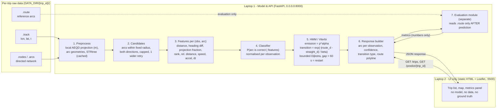

# PathSnap - System Architecture

PathSnap map-matches a noisy GPS trajectory to the trip's directed road network. It is
**candidate-based**: an ML classifier scores every (GPS observation, nearby road arc) pair,
then an **HMM/Viterbi** decoder picks the most plausible *connected* sequence of arcs.
The five required models (Logistic Regression, Gaussian NB, Random Forest,
HistGradientBoosting, MLP) are interchangeable scorers inside this one pipeline.

## Pipeline



**Training (offline, `experiments/`)**: labels come from aligning each GPS point of the 80
training trips to its `.route` arcs (monotonic DP, distance + heading, confidence flag);
a trip-level quality gate drops trips whose reference does not cover the track.
GroupKFold by trip; preprocessing fitted on training trips only; the 10 student-test trips
are used for model comparison; decoder parameters tuned on out-of-fold probabilities.
Saved to `artifacts/`: model, scaler, feature list, decoder config.

## Leakage boundaries
- Prediction path (`src/candidates`, `src/features`, `src/models`, `src/hmm`) never opens `.route`.
- `src/evaluation` reads `.route` after prediction, returns **numbers only**; no labels or
  reference geometry go into the response or the UI. Missing `.route` -> metrics `null`.
- `.route` is an arc *sequence*, not one label per GPS point. To score per-observation Top-1,
  the evaluation module runs the same monotonic route alignment used for training labels
  (server-side, after prediction) and compares each predicted arc with the aligned arc.
- Evaluator trips are never used for training, tuning, thresholds or model choice.
- No hardcoded predictions; every request runs the full pipeline (visible in API logs).

## API (Laptop 1)
`DATA_DIR` env var / `--data-dir` (default `student_test`; at evaluation the organisers' folder).

| Endpoint | Returns |
|---|---|
| `GET /health` | status, model name, data dir, number of trips |
| `GET /trips` | trip IDs found in `DATA_DIR` |
| `GET /predict/{trip_id}` | prediction response below |

Response contract of `/predict/{trip_id}`:
```json
{
  "trip_id": "00000007",
  "status": "ok",
  "gps_points": [[lat, lon], ...],
  "predictions": [{"observation_index": 0, "arc_id": 1234, "confidence": 0.93,
                   "margin": 0.71, "transition_type": "direct|multi_hop|relaxed|start|unmatched",
                   "fallback": false}, ...],
  "route_geometry": [[lat, lon], ...],
  "metrics": {"top1_accuracy": 0.91, "route_continuity": 0.98,
              "candidate_miss_rate": 0.01, "inference_time_ms": 850},
  "events": {"unmatched_points": 0, "relaxed_transitions": 2, "multi_hop_transitions": 40}
}
```
(Values above are a format example only, not results.) `transition_type` = `start` marks the
first point of a segment (trip start or restart after a gap > 60 s); it has no incoming
transition. Every request is logged to the
console: trip_id, status, latency.

## Two-laptop flow
1. Both laptops on the same Wi-Fi / hotspot. Laptop 1: `run_api.bat` (uvicorn on `0.0.0.0:8000`),
   port 8000 allowed in Windows Firewall; find its IP with `ipconfig`.
2. Laptop 2: `run_ui.bat` (`python -m http.server 5500` in `ui/`), open `http://localhost:5500`,
   enter `http://<laptop1-ip>:8000` as API base URL (default in `config.js`).
3. UI calls `GET /trips` -> evaluator clicks a trip -> UI calls `GET /predict/{trip_id}`.
4. Laptop 1 runs the full pipeline, computes metrics server-side, logs the request.
5. UI draws GPS points, predicted route (low-confidence / fallback points flagged), legend,
   metrics and events. Leaflet is vendored, so the UI works offline (basemap optional).
